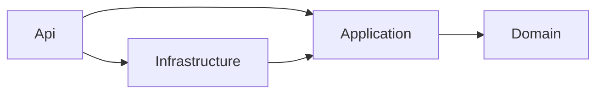
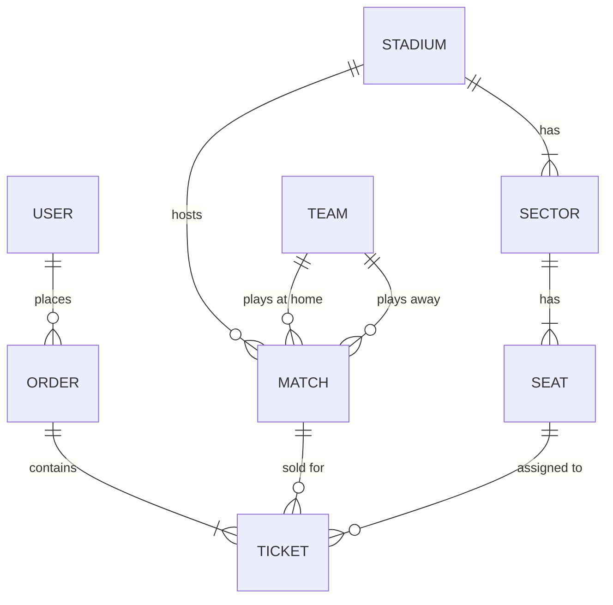

# Football Tickets API


REST API онлайн-сервиса продажи билетов на футбольные матчи: расписание, схема мест по секторам, покупка и отмена билетов с защитой от двойной продажи одного места.

## Возможности

- Регистрация и вход, JWT-аутентификация, роли `User` и `Admin`
- Список матчей с фильтрами (даты, команда) и пагинацией
- Схема мест матча по секторам: какие места свободны, цена каждого места
- Покупка 1-6 билетов одним заказом, цена зависит от сектора
- Защита от продажи одного места двум покупателям на уровне БД (частичный уникальный индекс)
- Отмена заказа не позднее чем за 24 часа до матча, места после отмены снова доступны
- Единый формат ошибок (ProblemDetails) и валидация входных данных
- Unit-тесты бизнес-правил и интеграционный тест на настоящем PostgreSQL

## Стек

- C#, .NET 10, ASP.NET Core Web API (controllers)
- Entity Framework Core, PostgreSQL (Npgsql), миграции
- JWT Bearer, FluentValidation, Serilog
- xUnit, Moq, Testcontainers
- Docker, docker-compose, GitHub Actions
- Scalar (интерактивная документация API)

## Быстрый старт

Нужен только Docker.

```bash
git clone https://github.com/ВАШ_ЛОГИН/football-tickets-api.git
cd football-tickets-api
docker compose up --build
```

После запуска:

- документация и пробные запросы: http://localhost:8080/scalar/v1
- при первом старте автоматически применяются миграции и заливаются тестовые данные (4 команды, стадион на 210 мест, 3 матча)

Тестовые учетные записи (**только для демо**):

| Роль | Email | Пароль |
|---|---|---|
| Admin | admin@tickets.local | Admin12345! |
| User | user@tickets.local | User12345! |

> Режим Development включен в compose ради демо (автомиграции, сидер, Scalar). В продакшене миграции запускают отдельным шагом, а секреты (строка подключения, ключ JWT) берут из хранилища секретов или переменных окружения.

### Запуск без Docker для API (только БД в контейнере)

```bash
docker compose up -d db

cd src/FootballTickets.Api
dotnet user-secrets init
dotnet user-secrets set "ConnectionStrings:Default" "Host=localhost;Port=5432;Database=football_tickets;Username=tickets;Password=tickets_dev_pass"
dotnet user-secrets set "Jwt:Key" "любая-длинная-случайная-строка-не-короче-32-символов"
dotnet run
```

## Архитектура

Решение разделено на четыре проекта по слоям:



```
src/
├─ FootballTickets.Domain/          сущности и перечисления, ни от чего не зависит
├─ FootballTickets.Application/     бизнес-логика, DTO, валидаторы, интерфейсы
├─ FootballTickets.Infrastructure/  EF Core, миграции, сидер, JWT, хэширование паролей
└─ FootballTickets.Api/             контроллеры, DI, аутентификация, обработка ошибок
tests/
├─ FootballTickets.Application.Tests/       unit-тесты бизнес-правил
└─ FootballTickets.Api.IntegrationTests/    тесты на PostgreSQL в контейнере
```

Зависимости направлены только внутрь: `Api -> Infrastructure -> Application -> Domain`. Domain не знает ни про EF Core, ни про ASP.NET. Application описывает, что ему нужно (`IAppDbContext`, `IPasswordService`, `IJwtTokenGenerator`, `ICurrentUser`), а Infrastructure и Api предоставляют реализации. Благодаря этому бизнес-логику можно тестировать без веб-сервера и без настоящей БД.

## Схема БД



Ключевые ограничения:

- `Users.Email` и `Teams.Name` уникальны
- `Seats (SectorId, Row, Number)` уникален
- `Matches`: проверка `HomeTeamId <> AwayTeamId`
- **`Tickets (MatchId, SeatId)` имеет частичный уникальный индекс `WHERE "IsCancelled" = false`**: на один матч одно место может принадлежать только одному неотмененному билету. Отмененные билеты остаются в истории и не мешают повторной продаже места.

Цена билета: `Match.BasePrice * Sector.PriceMultiplier`, фиксируется в билете в момент покупки.

## Ключевые решения

**Почему слои.** Чтобы бизнес-правила не зависели от способа хранения данных и веб-фреймворка, а правило зависимостей (стрелки только внутрь) проверялось структурой проектов.

**Почему без репозиториев и MediatR.** EF Core сам реализует паттерны Repository и Unit of Work, дополнительная обертка только добавляет код. MediatR и AutoMapper в новых версиях перешли на коммерческие лицензии, а для проекта такого размера хватает обычных сервисов и ручного маппинга в DTO.

**Защита от двойной продажи.** Проверка "место свободно" в коде нужна ради понятного сообщения об ошибке, но от гонки она не защищает: два параллельных запроса могут пройти ее одновременно. Окончательную гарантию дает частичный уникальный индекс: второй `SaveChanges` падает, и API возвращает `409 Conflict`. Заказ и все его билеты сохраняются одним `SaveChanges`, то есть в одной транзакции.

**Ошибки.** Сервисы бросают собственные исключения (`NotFoundException`, `ConflictException`, `BusinessRuleException` и др.), а единый `IExceptionHandler` превращает их в ответы ProblemDetails с нужным кодом (400, 401, 403, 404, 409). Ошибки валидации приходят с разбивкой по полям. Чужой заказ возвращает 404, а не 403, чтобы не раскрывать факт его существования.

**Время.** В сервисах используется `TimeProvider`, поэтому правило "отмена не позднее чем за 24 часа" проверяется в тестах с фиктивными часами.

**Аутентификация.** JWT с короткими именами claims (`sub`, `role`). Пароли хранятся только в виде хэша (`PasswordHasher`). На неверный email и неверный пароль возвращается одно и то же сообщение.

## Эндпоинты

| Метод | URL | Доступ | Описание |
|---|---|---|---|
| POST | `/api/auth/register` | все | Регистрация, возвращает JWT |
| POST | `/api/auth/login` | все | Вход, возвращает JWT |
| GET | `/api/matches` | все | Список матчей: `from`, `to`, `teamId`, `page`, `pageSize` |
| GET | `/api/matches/{id}` | все | Карточка матча |
| GET | `/api/matches/{id}/seats` | все | Места по секторам: свободно или занято, цена |
| POST | `/api/matches` | Admin | Создать матч |
| DELETE | `/api/matches/{id}` | Admin | Удалить матч (если нет активных билетов) |
| POST | `/api/orders` | User | Купить билеты: `matchId`, `seatIds` |
| GET | `/api/orders/my` | User | Мои заказы |
| GET | `/api/orders/{id}` | User | Свой заказ |
| POST | `/api/orders/{id}/cancel` | User | Отменить заказ |

## Примеры запросов

Готовая коллекция запросов лежит в файле [`requests.http`](requests.http) (Visual Studio, Rider, VS Code с REST Client). Ниже те же запросы через curl.

Вход:

```bash
curl -X POST http://localhost:8080/api/auth/login \
  -H "Content-Type: application/json" \
  -d '{"email":"user@tickets.local","password":"User12345!"}'
```

Список ближайших матчей:

```bash
curl "http://localhost:8080/api/matches?page=1&pageSize=10"
```

Схема мест матча:

```bash
curl http://localhost:8080/api/matches/{matchId}/seats
```

Покупка билетов (подставьте токен из ответа на вход):

```bash
curl -X POST http://localhost:8080/api/orders \
  -H "Authorization: Bearer $TOKEN" \
  -H "Content-Type: application/json" \
  -d '{"matchId":"{matchId}","seatIds":["{seatId1}","{seatId2}"]}'
```

Повторный запрос с теми же местами вернет `409 Conflict`.

## Запуск тестов

```bash
dotnet test
```

- Unit-тесты проверяют бизнес-правила `OrderService` (расчет суммы, покупка на начавшийся матч, занятое место, отмена менее чем за 24 часа, отмена чужого заказа, лимит в 6 мест). Работают на EF Core InMemory.
- Интеграционный тест запускает настоящий PostgreSQL через Testcontainers и проверяет, что при одновременной покупке одного места двумя пользователями ровно один получает `201`, а второй `409`. **Для него нужен запущенный Docker.**

InMemory-провайдер не проверяет уникальные индексы и внешние ключи, поэтому защита от гонки проверяется именно на реальной БД.

## Что бы улучшил

- резервирование мест на 10 минут с автоматическим освобождением (сейчас покупка мгновенная);
- реальная оплата через платежного провайдера и статусы заказа;
- уточнить перехват ошибки уникальности по коду PostgreSQL `23505` (сейчас перехватывается любая `DbUpdateException` при сохранении заказа);
- refresh-токены и хранение хэшей токенов;
- кэширование списка матчей и схемы мест;
- перенос части правил внутрь сущностей (богатая доменная модель);
- rate limiting на вход и регистрацию;
- health checks и метрики;
- отправка билета на почту через очередь;
- решить, что делать с удалением матча, у которого остались только отмененные билеты (сейчас внешний ключ его не пропустит).
