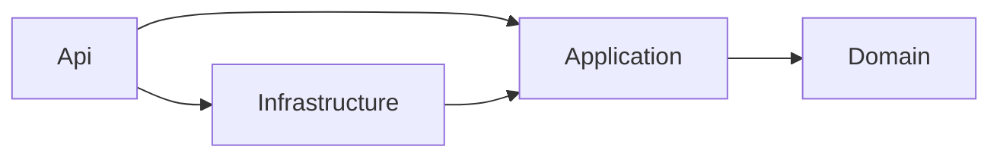
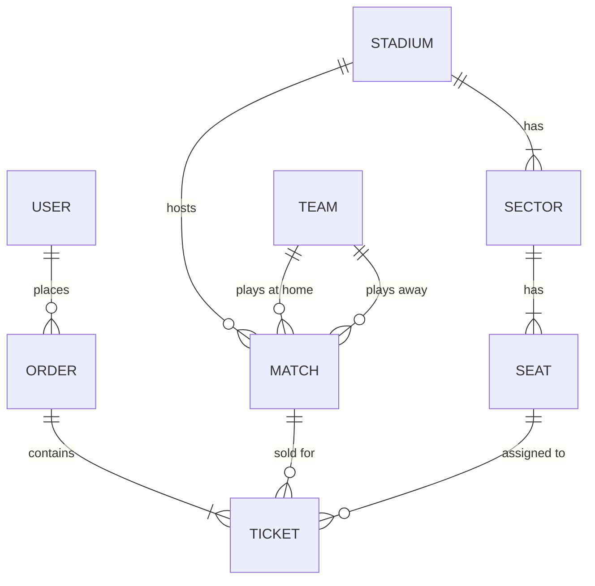

# Football Tickets


Сервис продажи билетов на футбольные матчи: сайт на Blazor со схемой стадиона и REST API на ASP.NET Core. Я сделал его как главный проект для портфолио, поэтому постарался собрать все как в настоящей разработке: слои, база с миграциями, JWT, тесты, Docker и деплой на свой сервер.

**Демо:** https://football-tickets.duckdns.org (демо-проект, оплата не настоящая)

| Список матчей | Выбор мест | Мои заказы |
|---|---|---|
|  |  |  |

## Что умеет

- Регистрация и вход, JWT, роли `User` и `Admin`
- Список матчей с фильтром по команде и пагинацией
- Схема стадиона: кликаю по местам, цвет показывает свободно, выбрано или занято, цена зависит от сектора
- Покупка от 1 до 6 билетов одним заказом
- Одно место нельзя продать дважды, даже если двое жмут "Купить" одновременно (защита на уровне базы, подробнее ниже)
- Отмена заказа не позднее чем за 24 часа до матча, после отмены места снова продаются
- Админка: создание и удаление матчей
- Время матчей показывается в часовом поясе браузера
- Ограничение попыток входа и регистрации (10 в минуту с одного IP)
- Единый формат ошибок (ProblemDetails), на сайте пользователь видит понятный текст

## Стек

- C#, .NET 10, ASP.NET Core Web API
- Entity Framework Core, PostgreSQL, миграции
- Blazor WebAssembly, Bootstrap
- JWT Bearer, FluentValidation, Serilog
- xUnit, Moq, Testcontainers
- Docker, Docker Compose, Caddy, GitHub Actions
- Scalar для документации API

## Быстрый старт

Нужен только Docker.

```bash
git clone https://github.com/VolkovKonstantin0105/football-tickets-api.git
cd football-tickets-api
cp .env.example .env
```

Откройте `.env` и впишите свои значения. Для локального запуска оставьте `DOMAIN=localhost`, остальное (пароль базы, ключ JWT, email и пароль админа) придумайте или сгенерируйте. В паролях лучше использовать только буквы и цифры, спецсимволы ломают разбор `.env`.

```bash
docker compose -f docker-compose.prod.yml up --build
```

После запуска откройте https://localhost. Браузер предупредит о сертификате: это нормально, Caddy выписывает локальный сертификат для localhost, примите риск. Войти можно админом из `.env`, а обычного пользователя создайте через регистрацию.

На сервере демо-пользователей с известными паролями нет вообще: админ создается из переменных окружения, остальные регистрируются сами.

### Только API (с Scalar и тестовыми пользователями)

Если нужен только API без сайта:

```bash
docker compose up --build
```

Документация и пробные запросы: http://localhost:8080/scalar/v1. В этом режиме (Development) создаются тестовые пользователи, только для демо:

| Роль | Email | Пароль |
|---|---|---|
| Admin | admin@tickets.local | Admin12345! |
| User | user@tickets.local | User12345! |

### Запуск API без Docker (база в контейнере)

```bash
docker compose up -d db

cd src/FootballTickets.Api
dotnet user-secrets init
dotnet user-secrets set "ConnectionStrings:Default" "Host=localhost;Port=5432;Database=football_tickets;Username=tickets;Password=tickets_dev_pass"
dotnet user-secrets set "Jwt:Key" "любая-длинная-случайная-строка-не-короче-32-символов"
dotnet run
```

Когда правлю интерфейс, пересобираю только образ сайта: `docker compose -f docker-compose.prod.yml up -d --build caddy`.

## Архитектура

Решение разделено на четыре проекта по слоям, плюс отдельный проект сайта:



```
src/
├─ FootballTickets.Domain/          сущности и перечисления, ни от чего не зависит
├─ FootballTickets.Application/     бизнес-логика, DTO, валидаторы, интерфейсы
├─ FootballTickets.Infrastructure/  EF Core, миграции, сидер, JWT, хэширование паролей
├─ FootballTickets.Api/             контроллеры, DI, аутентификация, обработка ошибок
└─ FootballTickets.Web/             сайт на Blazor WebAssembly
tests/
├─ FootballTickets.Application.Tests/       unit-тесты бизнес-правил
└─ FootballTickets.Api.IntegrationTests/    тесты на PostgreSQL в контейнере
```

Зависимости идут только внутрь: `Api -> Infrastructure -> Application -> Domain`. Domain ничего не знает ни про EF Core, ни про ASP.NET. Application сам описывает, что ему нужно (`IAppDbContext`, `IPasswordService`, `IJwtTokenGenerator`, `ICurrentUser`), а реализации лежат в Infrastructure и Api. Благодаря этому бизнес-логику можно тестировать без веб-сервера и без настоящей базы.

Сайт (Web) не ссылается на остальные проекты: он общается с API только по HTTP, как любой внешний клиент.

## Схема БД



Что важно в схеме:

- `Users.Email` и `Teams.Name` уникальны
- `Seats (SectorId, Row, Number)` уникален
- В `Matches` есть проверка, что хозяева и гости это разные команды
- **В `Tickets` частичный уникальный индекс по `(MatchId, SeatId)` с условием `"IsCancelled" = false`.** На один матч одно место может принадлежать только одному неотмененному билету. Отмененные билеты остаются в истории и не мешают продать место заново.

Цена билета считается как `Match.BasePrice * Sector.PriceMultiplier` и фиксируется в билете в момент покупки.

## Как устроен деплой

Все крутится в Docker Compose на одном VPS:

```
браузер --HTTPS--> Caddy (порты 80 и 443)
                     |
                     +-- /api/*  ---> API (порт 8080, виден только внутри Docker) ---> PostgreSQL (порт 5432, тоже внутри)
                     |
                     +-- остальное -> статические файлы Blazor
```

Caddy сам получает HTTPS-сертификат у Let's Encrypt, раздает файлы сайта и проксирует запросы на `/api/` в контейнер с API. Для браузера сайт и API живут на одном адресе, поэтому CORS не нужен. Наружу открыты только 80 и 443 (и SSH на самом сервере), база и API снаружи недоступны.

Развернуть у себя:

```bash
git clone https://github.com/ВАШ_ЛОГИН/football-tickets-api.git
cd football-tickets-api
cp .env.example .env
nano .env        # DOMAIN, пароль базы, ключ JWT, email и пароль админа
chmod 600 .env
docker compose -f docker-compose.prod.yml up -d --build
```

`.env.example` это шаблон, настоящий `.env` в репозиторий не попадает и хранится только на сервере. Миграции и начальные данные (команды, стадион, матчи) применяются при старте API. Админ создается из `ADMIN_EMAIL` и `ADMIN_PASSWORD`.

Обновление: `git pull` и снова `docker compose -f docker-compose.prod.yml up -d --build`. Бэкап базы делаю ночью через `pg_dump` по cron и периодически забираю копию на свой компьютер.

## Ключевые решения

**Почему слои.** Чтобы бизнес-правила не зависели ни от базы, ни от веб-фреймворка, а правило "зависимости только внутрь" проверялось самой структурой проектов.

**Почему без репозиториев и MediatR.** EF Core уже сам реализует Repository и Unit of Work, отдельная обертка только добавляет код. MediatR и AutoMapper в новых версиях стали коммерческими, а для проекта такого размера хватает обычных сервисов и ручного маппинга в DTO.

**Защита от двойной продажи.** Проверка "место свободно" в коде нужна ради понятной ошибки, но от гонки она не спасает: два запроса могут пройти ее одновременно. Реальная гарантия это частичный уникальный индекс. Второй `SaveChanges` падает, и API отвечает `409 Conflict`. Заказ и все его билеты сохраняются одним `SaveChanges`, то есть в одной транзакции. Проверяю это интеграционным тестом на настоящем PostgreSQL.

**Ошибки.** Сервисы бросают свои исключения (`NotFoundException`, `ConflictException` и другие), а один обработчик превращает их в ProblemDetails с нужным кодом. Чужой заказ возвращает 404, а не 403, чтобы не раскрывать, что он существует.

**Время.** В сервисах `TimeProvider`, поэтому правило "отмена за 24 часа" проверяется в тестах с фиктивными часами. На сайте время матча я перевожу в часовой пояс браузера через JavaScript, потому что в WebAssembly часовой пояс .NET не всегда совпадает с браузерным.

**Аутентификация.** JWT с короткими именами claims (`sub`, `role`). Пароли только в виде хэша, на неверный email и неверный пароль один и тот же ответ. На сайте токен лежит в localStorage (про компромисс ниже).

## Эндпоинты

| Метод | URL | Доступ | Описание |
|---|---|---|---|
| POST | `/api/auth/register` | все | Регистрация, возвращает JWT |
| POST | `/api/auth/login` | все | Вход, возвращает JWT |
| GET | `/api/matches` | все | Список матчей: `from`, `to`, `teamId`, `page`, `pageSize` |
| GET | `/api/matches/{id}` | все | Карточка матча |
| GET | `/api/matches/{id}/seats` | все | Места по секторам: свободно или занято, цена |
| POST | `/api/matches` | Admin | Создать матч |
| DELETE | `/api/matches/{id}` | Admin | Удалить матч (если нет активных билетов) |
| GET | `/api/teams` | все | Список команд |
| GET | `/api/stadiums` | все | Список стадионов |
| POST | `/api/orders` | User | Купить билеты: `matchId`, `seatIds` |
| GET | `/api/orders/my` | User | Мои заказы |
| GET | `/api/orders/{id}` | User | Свой заказ |
| POST | `/api/orders/{id}/cancel` | User | Отменить заказ |

В файле [`requests.http`](requests.http) лежат готовые запросы (Visual Studio, Rider, VS Code с REST Client). Вот те же через curl, если API запущен локально на порту 8080:

```bash
# вход
curl -X POST http://localhost:8080/api/auth/login \
  -H "Content-Type: application/json" \
  -d '{"email":"user@tickets.local","password":"User12345!"}'

# ближайшие матчи
curl "http://localhost:8080/api/matches?page=1&pageSize=10"

# схема мест матча
curl http://localhost:8080/api/matches/{matchId}/seats

# покупка (токен из ответа на вход)
curl -X POST http://localhost:8080/api/orders \
  -H "Authorization: Bearer $TOKEN" \
  -H "Content-Type: application/json" \
  -d '{"matchId":"{matchId}","seatIds":["{seatId1}","{seatId2}"]}'
```

Повторный запрос с теми же местами вернет `409 Conflict`. Пример с `user@tickets.local` работает в режиме "только API" (Development), на сервере таких пользователей нет.

## Тесты

```bash
dotnet test
```

- Unit-тесты проверяют правила `OrderService`: расчет суммы, покупка на начавшийся матч, занятое место, отмена меньше чем за 24 часа, отмена чужого заказа, лимит в 6 мест. Работают на EF Core InMemory.
- Интеграционный тест поднимает настоящий PostgreSQL через Testcontainers и проверяет, что при одновременной покупке одного места двумя пользователями ровно один получает `201`, а второй `409`. **Для него нужен запущенный Docker.**

InMemory не проверяет уникальные индексы, поэтому защиту от гонки я проверяю именно на реальной базе.

## Что бы я улучшил

- резервирование мест на 10 минут с автоматическим освобождением (сейчас покупка мгновенная);
- реальная оплата через платежного провайдера и статусы заказа;
- ловить ошибку уникальности точнее, по коду PostgreSQL `23505` (сейчас перехватывается любая `DbUpdateException` при сохранении заказа);
- refresh-токены, а токен хранить не в localStorage, а в httpOnly cookie, чтобы кража через XSS ничего не давала;
- инвайт-коды для регистрации, сейчас зарегистрироваться может любой, кто знает адрес;
- админские методы для команд и стадионов (сейчас их можно только выбирать из того, что залито при старте);
- решить, что делать с удалением матча, у которого остались только отмененные билеты (сейчас внешний ключ его не пропустит);
- кэширование списка матчей и схемы мест;
- перенести часть правил внутрь сущностей (богатая доменная модель);
- тесты компонентов Blazor (bUnit);
- автоматический деплой из GitHub Actions: сборка образов, публикация в реестр, обновление на сервере по SSH;
- бэкапы базы не только на сервере, а во внешнее хранилище;
- health checks, метрики и алерты;
- отправка билета на почту через очередь.
